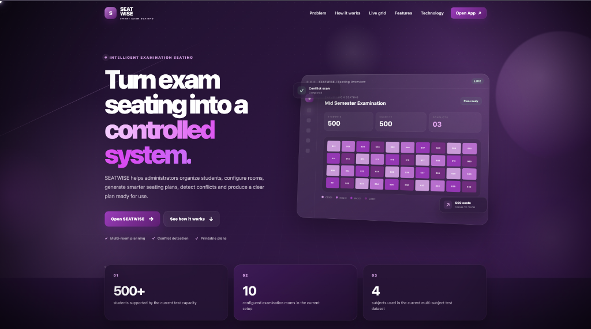
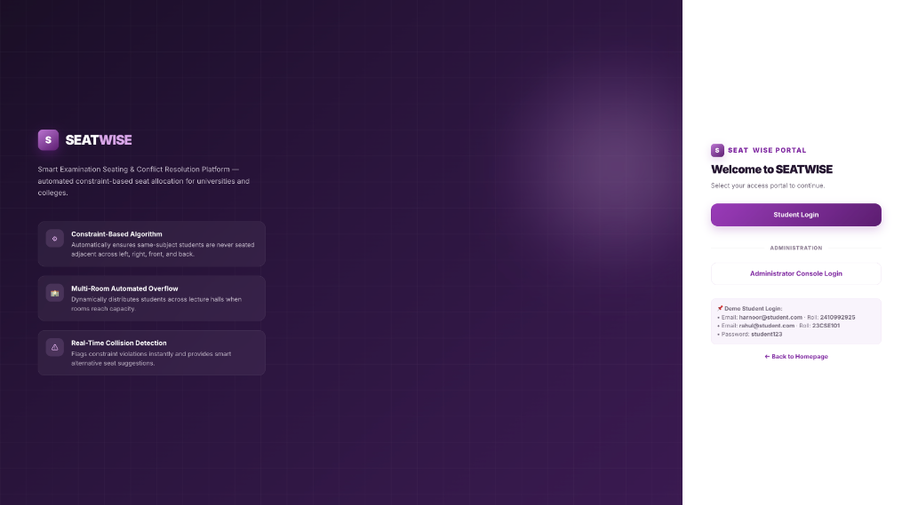
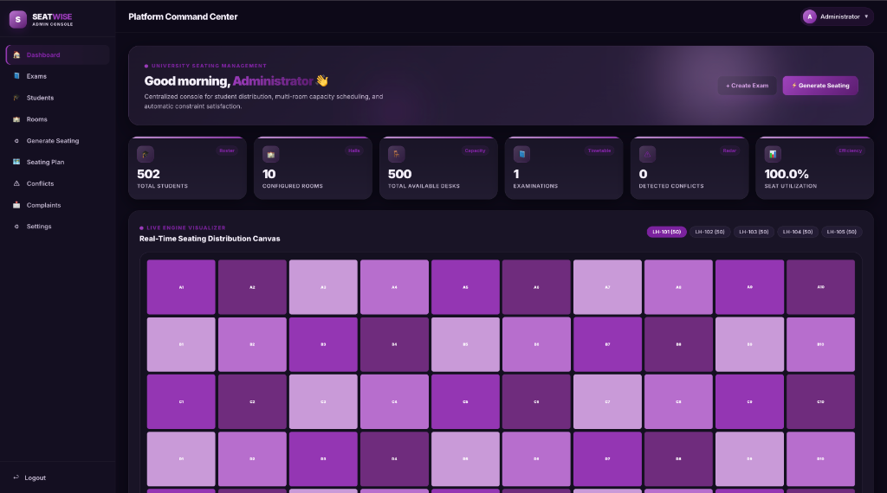
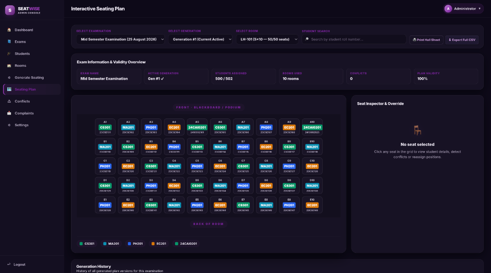
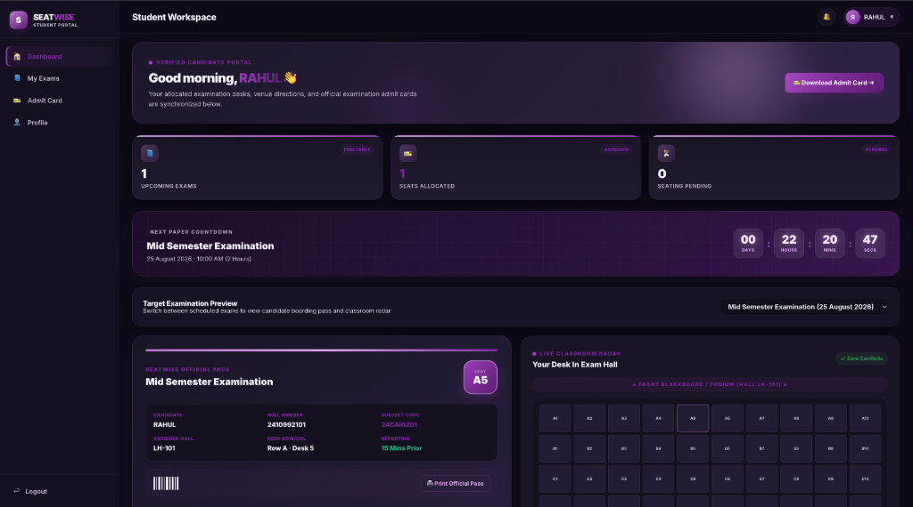
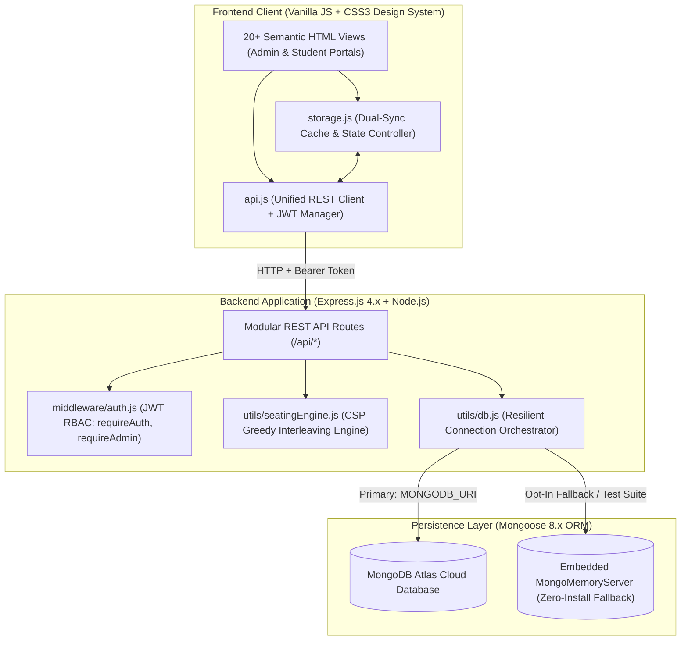
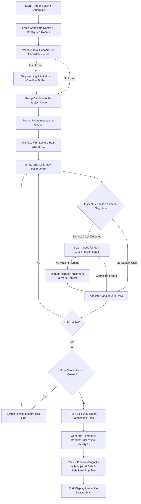
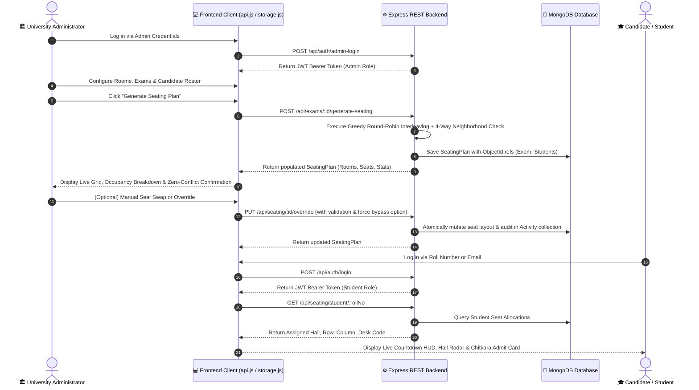

# 🎓 SEATWISE (v2.0.0)
### Intelligent Examination Seating Allocation, Real-Time Conflict Resolution & Academic Administration Platform

<div align="center">



[](https://github.com/Harnoorkaur06/Seatwise)
[](https://github.com/Harnoorkaur06/Seatwise)
[](https://github.com/Harnoorkaur06/Seatwise)
[](https://github.com/Harnoorkaur06/Seatwise)
[](https://github.com/Harnoorkaur06/Seatwise)
[-brightgreen.svg?style=for-the-badge&logo=checkmarx&logoColor=white)](https://github.com/Harnoorkaur06/Seatwise)
[](https://github.com/Harnoorkaur06/Seatwise)

<p align="center">
  <b>A production-grade, constraint-driven examination seating allocation and administration platform that eliminates same-course student adjacencies across multi-hall university campuses.</b>
</p>

[✨ Live Demo & Quick Start](#-quick-start--setup-guide) •
[📸 UI Showcase](#-interface-showcase--visual-tour) •
[🧩 Seating Algorithm](#-the-seating-algorithm-core-academic-contribution) •
[🏗️ Architecture & Flowcharts](#-system-architecture--engine-flowcharts) •
[🔌 REST API Reference](#-rest-api-specification) •
[🗄️ Database Schemas](#-database-models--mongoose-relational-architecture) •
[⚙️ Key Features](#-key-platform-features) •
[🧪 Automated Tests](#-automated-testing-suite)

---

</div>

## 📌 Executive Summary

Examination seating arrangements in modern universities present a classic **NP-hard Constraint Satisfaction Problem (CSP)**. When hundreds of candidates from disparate disciplines (*Artificial Intelligence, Computer Science, Mathematics, Physics, Electronics*) are seated in shared lecture halls, manual or naive seat allocation inevitably causes adjacent same-subject placements—increasing unfair academic exposure and logistical overhead.

**SEATWISE (v2.0.0 — Evaluation CE2 Final Edition)** elevates university exam administration into a full-stack, enterprise-grade platform. Powered by a deterministic, round-robin interleaving engine and backed by **Node.js, Express.js, MongoDB Atlas (with Mongoose ORM)**, and an asynchronous dual-sync client layer, SEATWISE guarantees:

> 🛡️ **The 4-Way Adjacency Rule:** No two students appearing for the same subject or course code are ever placed directly adjacent to each other (**Left**, **Right**, **Front**, or **Back**). Diagonal seating is intentionally permitted to maximize lecture hall capacity utilization while eliminating academic collisions.

---

## 📸 Interface Showcase & Visual Tour

### 1. Modern SaaS Landing Page
> *A high-converting, presentation-ready portal explaining platform value propositions, live seat distribution preview, and performance statistics.*

<div align="center">
  
</div>

* **Features:** Animated background blobs, live 500-seat simulation canvas, feature comparison matrix, and responsive cross-device navigation.

---

### 2. Multi-Role Unified Portal Login
> *Frictionless authentication gateway for University Administrators and Students with pre-seeded demo accounts and JWT token persistence.*

<div align="center">
  
</div>

* **Features:** Single-click demo credentials, stateless JSON Web Token (JWT) session control, role-based route gating (RBAC), and custom student password onboarding.

---

### 3. Administrator Command Center & Live Telemetry
> *Executive dashboard with real-time room capacity tracking, examination timetables, and interactive live distribution matrix.*

<div align="center">
  
</div>

* **Features:** Instant statistical telemetry (Total Roster, Configured Halls, Available Desks, Detected Conflicts, Utilization Rate), active hall switching tabs, and one-click quick actions.

---

### 4. Interactive Seating Plan Grid & Manual Override Inspector
> *Full-fidelity room grid renderer with color-coded subject indicators, generation version history, and smart swap collision advisor.*

<div align="center">
  
</div>

* **Features:** Multi-exam & multi-room dropdown selectors, search by candidate roll number, live seat inspector side-panel, manual seat override with `PUT /api/seating/:id/override`, CSV export, and high-resolution print sheet generator.

---

### 5. Student Workspace & Live Exam Countdown HUD
> *Personalized candidate portal featuring live ticking countdown clocks, allocated desk radar, and digital boarding pass.*

<div align="center">
  
</div>

* **Features:** Real-time exam countdown timer HUD (Days, Hours, Minutes, Seconds), holographic boarding pass with barcode simulation, mini classroom radar spotlighting target desk position, and instant official Chitkara University Admit Card PDF download.

---

## 🏗️ System Architecture & Engine Flowcharts

### 🌐 End-to-End Full-Stack Architecture



---

### 🔄 Seating Generation & Constraint Verification Flow



---

### 👥 Multi-Role User Journey & Interaction Model



---

## 🧠 The Seating Algorithm (Core Academic Contribution)

The core engine is implemented in both the backend ([`backend/utils/seatingEngine.js`](backend/utils/seatingEngine.js)) and mirrored for instant client-side preview in ([`frontend/js/seatingAlgorithm.js`](frontend/js/seatingAlgorithm.js)). It implements a multi-stage heuristic pipeline:

### 1. Subject-Aware Round-Robin Interleaving
Rather than attempting random placement, students are partitioned by their registered `subject` (e.g., `24APS4101`, `CS301`, `MA201`, `PH201`). The queues are sorted in descending order of candidate volume and interleaved round-robin. This guarantees maximum initial subject dispersion before physical seat assignment begins.

### 2. Greedy Row-Major Placement with 4-Way Neighborhood Checking
For each seat $(r, c)$ in a room:
$$\text{Neighbourhood}(r, c) = \{(r, c-1), (r-1, c), (r, c+1), (r+1, c)\}$$
During placement, inspecting the immediate Left $(r, c-1)$ and Top $(r-1, c)$ neighbors is mathematically sufficient because future Right and Bottom assignments enforce identical checks when their respective turn arrives.

### 3. Multi-Hall Automated Overflow Balancing
When Lecture Hall 1 reaches $100\%$ capacity ($R \times C = 50$ desks), the queue smoothly transitions to Lecture Hall 2, maintaining uniform subject dispersion across halls without resetting the interleaver state.

### 4. Independent Global Verification Pass
After every room is generated, an independent scanner inspects all 4 orthogonal directions for every single desk. If an edge-case subject skew causes a collision, it is recorded in `plan.conflicts` with exact desk coordinates, conflicting student details, and subject codes.

### 5. Smart Conflict Resolution & Interactive Swap Advisor
When an administrator drags or swaps students in the interactive seating plan:
* `PUT /api/seating/:id/override` executes real-time collision detection before committing.
* If a collision would be created, the engine flags the conflict while providing a `force: true` parameter for emergency administrator exceptions.
* The frontend advisor computes and highlights alternative non-conflicting desks automatically.

---

## 🔌 REST API Specification

The Express backend exposes a comprehensive, RESTful API mounted under `/api`. All protected endpoints enforce stateless JWT verification via the `Authorization: Bearer <token>` header.

### 1. Authentication & Security (`/api/auth`)

| Method | Endpoint | Access | Description |
|---|---|---|---|
| `POST` | `/api/auth/admin-login` | Public | Authenticates platform administrator; returns JWT token. |
| `POST` | `/api/auth/login` | Public | Authenticates student by University Roll Number or Email. |
| `POST` | `/api/auth/setup-password` | Public | First-time student onboarding password configuration. |
| `POST` | `/api/auth/update-password` | Authenticated | Updates account password (requires current password). |
| `GET` | `/api/auth/me` | Authenticated | Retrieves current authenticated user profile & role. |
| `POST` | `/api/auth/logout` | Authenticated | Client-side session teardown and token revocation. |

### 2. Candidate & Student Registry (`/api/students`)

| Method | Endpoint | Access | Description |
|---|---|---|---|
| `GET` | `/api/students` | Authenticated | Lists all registered students; supports `?q=<term>` search. |
| `GET` | `/api/students/:idOrRoll` | Authenticated | Looks up student by `_id`, `id`, `rollNo`, or `email`. |
| `POST` | `/api/students` | Admin Only | Creates or upserts a student record directly into MongoDB. |
| `PUT` | `/api/students/:idOrRoll` | Admin / Self | Updates student profile details, courses, or contact info. |
| `DELETE` | `/api/students/:idOrRoll` | Admin Only | Removes candidate from database. |
| `POST` | `/api/students/import` | Admin Only | Bulk imports an array of candidate records. |

### 3. Lecture Halls & Rooms (`/api/rooms`)

| Method | Endpoint | Access | Description |
|---|---|---|---|
| `GET` | `/api/rooms` | Public / Auth | Lists all configured lecture halls and seat capacities. |
| `POST` | `/api/rooms` | Admin Only | Configures new lecture hall ($R \times C$ grid matrix). |
| `PUT` | `/api/rooms/:roomNumber` | Admin Only | Updates hall dimensions, capacity, or active status. |
| `DELETE` | `/api/rooms/:roomNumber` | Admin Only | Removes lecture hall configuration. |

### 4. Examination Scheduling (`/api/exams`)

| Method | Endpoint | Access | Description |
|---|---|---|---|
| `GET` | `/api/exams` | Public / Auth | Lists all scheduled exams, course codes, and sessions. |
| `GET` | `/api/exams/active` | Public / Auth | Retrieves currently active or nearest upcoming exam. |
| `POST` | `/api/exams` | Admin Only | Schedules new examination timetable entry. |
| `PUT` | `/api/exams/:id` | Admin Only | Modifies exam date, time slot, course code, or status. |
| `DELETE` | `/api/exams/:id` | Admin Only | Removes examination schedule entry. |
| `POST` | `/api/exams/:id/generate-seating` | Admin Only | Triggers automated seating generation for specified exam. |

### 5. Seating Plan & Conflict Allocation (`/api/seating`)

| Method | Endpoint | Access | Description |
|---|---|---|---|
| `GET` | `/api/seating` | Public / Auth | Lists all generated seating plans (supports `?examId=`). |
| `GET` | `/api/seating/:examId` | Public / Auth | Retrieves seating plan for exam (supports `?generation=`). |
| `POST` | `/api/seating/generate` | Admin Only | Generates 4-way conflict-free seating plan. |
| `POST` | `/api/seating/regenerate` | Admin Only | Recomputes plan incrementing generation version tag. |
| `PUT` | `/api/seating/:id/override` | Admin Only | Applies atomic seat override/swap with conflict validation. |
| `POST` | `/api/seating/force-override` | Admin Only | Bypasses conflict checks to force manual seat placement. |
| `GET` | `/api/seating/student/:rollNo` | Authenticated | Retrieves allocated hall, desk, and exam pass for student. |
| `DELETE` | `/api/seating/:examId` | Admin Only | Clears generated seating plans for specific exam. |

### 6. Student Inquiries & Grievances (`/api/complaints`)

| Method | Endpoint | Access | Description |
|---|---|---|---|
| `GET` | `/api/complaints` | Admin / Auth | Lists filed inquiries (supports `?status=` and `?rollNo=`). |
| `POST` | `/api/complaints` | Authenticated | Submits new examination seat grievance or discrepancy. |
| `PUT` | `/api/complaints/:id` | Admin Only | Updates inquiry resolution status and admin response notes. |
| `GET` | `/api/complaints/unread-count` | Admin Only | Telemetry count of unresolved student inquiries. |
| `POST` | `/api/complaints/clear-unread`| Admin Only | Marks pending complaints as reviewed. |

### 7. System Diagnostics & Health (`/api/system` & `/health`)

| Method | Endpoint | Access | Description |
|---|---|---|---|
| `GET` | `/health` / `/api/health` | Public | Health check reporting database connection & uptime. |
| `GET` | `/api/system/stats` | Public / Auth | Database counts: students, rooms, exams, plans, complaints. |
| `POST` | `/api/system/seed` | Admin Only | Seeds baseline lecture halls, sample students, and timetable. |
| `POST` | `/api/system/purge` | Admin Only | Purges generated plans and activity logs safely. |
| `POST` | `/api/migrate/import-browser-data` | Admin Only | Imports legacy browser LocalStorage payload to MongoDB. |

---

## 🗄️ Database Models & Mongoose Relational Architecture

The data layer uses **Mongoose 8.x** with relational schema design and `populate()` references:

```
                  ┌──────────────────────┐
                  │       User           │
                  │ (admin / student)    │
                  └──────────┬───────────┘
                             │
                             ├───────────────────────┐
                             ▼                       ▼
                  ┌──────────────────────┐┌──────────────────────┐
                  │      Student         ││     Complaint        │
                  │ (users collection)   ││                      │
                  └──────────┬───────────┘└──────────────────────┘
                             │
                             ▼ (referenced by ObjectId)
┌──────────────┐  ┌──────────────────────────────────────────────┐
│     Exam     │◄─┤                 SeatingPlan                  │
│              │  │  - exam: ObjectId (ref: "Exam")              │
└──────────────┘  │  - rooms.seats.student: ObjectId             │
                  │    (ref: "Student")                          │
┌──────────────┐  │  - rooms[].roomNumber (ref: Room)            │
│     Room     │  │  - conflicts, unassigned, stats              │
│ (LH-101..110)│  └──────────────────────────────────────────────┘
└──────────────┘
```

### Relational Populate Helper
The `SeatingPlan` model provides a built-in helper method `.populateFull()` that deeply resolves related entities in a single query:

```javascript
SeatingPlanSchema.methods.populateFull = function() {
  return this.populate([
    { path: "exam" },
    { path: "rooms.seats.student", select: "-password -__v" }
  ]);
};
```

---

## ⚙️ Key Platform Features

| Module | Core Functionality |
|---|---|
| **🏛️ Admin Command Center** | Statistical cards, live hall occupancy, active exam distribution overview, quick navigation. |
| **📘 Exam Management** | Full CRUD for university examinations, dates, session slots, course codes, and semesters. |
| **🎓 Student Registry** | Auto-provisions 500+ candidates with distinct Father Names, Class/Branch, and Unique University IDs (`241099xxxx`). Direct MongoDB Atlas sync. |
| **🏫 Room Configuration** | Custom row $\times$ column matrix builder (e.g., $5 \times 10 = 50$ seats), hall name assignment, and capacity calculators. |
| **⚙️ Seating Plan Generator** | 5-step animated console stepper, live progress logs, multi-generation versioning (`Gen #1`, `Gen #2`), and relational population. |
| **🗺️ Seating Plan Matrix** | Color-coded subject nodes, candidate roll search, seat inspector panel, manual student swapping (`PUT /override`), and CSV export. |
| **🎫 Chitkara Admit Card** | Print-optimized A4 Admit Card generator with official university logo, candidate info, courses table, and Dean seal stamp. |
| **⚡ Conflict Radar** | Real-time orthogonal adjacency scanning, conflict logging, and intelligent non-conflicting seat suggestions. |
| **📬 Complaints Desk** | Student inquiry submission and administrative resolution dashboard with unread counters. |
| **🌓 Theme & Appearance Engine** | Comprehensive Dark/Light mode engine, sidebar collapse state, and 5 accent color palettes (*Purple, Indigo, Emerald, Orange, Rose*). |

---

## ⚡ Quick Start & Setup Guide

### Prerequisites
* **Node.js**: v18.0.0 or higher
* **npm**: v9.0.0 or higher
* **MongoDB**: A running local MongoDB instance (`mongodb://localhost:27017/seatwise`) or a free [MongoDB Atlas](https://www.mongodb.com/atlas) connection URI.  
  *(Optional: If no MongoDB is installed, set `USE_IN_MEMORY_DB=true` in `.env` for zero-install evaluation).*

---

### 1. Clone & Install Dependencies

```bash
# Clone the repository
git clone https://github.com/Harnoorkaur06/Seatwise.git
cd Seatwise

# Install root & backend dependencies
npm install
```

---

### 2. Environment Configuration

Copy the environment template or create a `backend/.env` file:

```bash
cp backend/.env.example backend/.env
```

Review or modify your `backend/.env` settings:

```ini
# Server Port & Mode
PORT=3000
NODE_ENV=development

# Persistent MongoDB Connection (Local or Atlas)
MONGODB_URI=mongodb://localhost:27017/seatwise

# Optional: Set to true for zero-install evaluation without a running MongoDB service
USE_IN_MEMORY_DB=false

# Security & Authentication
JWT_SECRET=seatwise_production_super_secret_key_2026
JWT_EXPIRES_IN=7d

# Initial Administrator Provisioning
ADMIN_USERNAME=admin
ADMIN_PASSWORD=seatwise@admin123
```

---

### 3. Run the Application

| Command | Action |
|---|---|
| `npm start` | Launches the production Express server at `http://localhost:3000` |
| `npm run dev` | Starts server with `nodemon` hot-reloading for development |
| `npm test` | Runs the 32-test automated integration test suite |
| `npm run seed` | Seeds baseline lecture halls, sample students, and exam slots |

```bash
# Launch development server
npm run dev
```

Visit **`http://localhost:3000`** in your browser. The Express server serves both the REST API and all frontend views seamlessly.

---

## 🔑 Demo Credentials

| Role | Username / Identifier | Password | Access Level |
|---|---|---|---|
| **👑 Platform Administrator** | `admin` *(or `admin@seatwise.local`)* | `seatwise@admin123` | Full administrative control, room generator, plan creator, conflict overrides |
| **🎓 Candidate (Student 1)** | `2410992925` *(or `harnoor@student.com`)* | `student123` | Student Workspace, Exam Timetable, Hall Radar, Official Admit Card |
| **🎓 Candidate (Student 2)** | `2410992101` *(or `rahul@student.com`)* | `student123` | Student Workspace, Exam Timetable, Hall Radar, Official Admit Card |

> 💡 *Note: The system automatically provisions accounts for any generated student. Any candidate can log in using either their **University Roll Number** or registered **Email Address**.*

---

## 🗂️ Project Directory Structure

```
Seatwise/
├── package.json                    # Root package configuration & npm scripts
├── MIGRATION_PROGRESS.md           # Backend migration checklist & test report
├── PHASE2_BACKEND_SPEC.md          # Full-stack MERN specification & endpoint contract
├── README.md                       # Comprehensive platform documentation
├── backend/
│   ├── server.js                   # Express server entrypoint, middleware & static hosting
│   ├── package.json                # Backend dependencies (Express, Mongoose, JWT, bcrypt)
│   ├── nodemon.json                # Development hot-reload configuration
│   ├── .env                        # Active environment secrets & MongoDB connection string
│   ├── .env.example                # Configuration template
│   ├── models/
│   │   ├── User.js                 # Authentication, bcrypt password hashing, roles
│   │   ├── Student.js              # Student schema mapped to users collection
│   │   ├── Room.js                 # Lecture hall dimensions & capacity
│   │   ├── Exam.js                 # Examination timetable, sessions & course codes
│   │   ├── SeatingPlan.js          # Relational seating plan with ObjectId refs & .populate()
│   │   ├── Complaint.js            # Student grievances & resolution status
│   │   ├── Activity.js             # Administrative audit trail logs
│   │   ├── ExamReminder.js         # Automated candidate notifications
│   │   └── OtpChallenge.js         # MFA & OTP verification challenges
│   ├── routes/
│   │   ├── auth.js                 # Login, admin-login, password setup, /me, logout
│   │   ├── students.js             # Student CRUD, search, filter, upsert, bulk import
│   │   ├── rooms.js                # Hall CRUD, capacity calculations, active state toggles
│   │   ├── exams.js                # Timetable CRUD, active exam, /generate-seating
│   │   ├── seating.js              # Seating generation, PUT /override, export, student lookup
│   │   ├── complaints.js           # Grievance submission, status updates, unread count
│   │   ├── activity.js             # Audit trail query & logging
│   │   ├── system.js               # Diagnostics, health telemetry, seed & purge
│   │   └── migrate.js              # LocalStorage to MongoDB migration importer
│   ├── middleware/
│   │   └── auth.js                 # JWT verification, requireAuth, requireAdmin guards
│   ├── utils/
│   │   ├── db.js                   # Resilient MongoDB Atlas / local / In-Memory connector
│   │   └── seatingEngine.js        # Node.js 4-way CSP interleaving & adjacency engine
│   ├── scripts/
│   │   └── seed.js                 # Non-destructive idempotent baseline data seeder
│   ├── data/
│   │   └── sample-students.json    # Pre-generated candidate roster (500+ records)
│   └── test/
│       └── run-tests.js            # Comprehensive 32-test automated test suite
├── frontend/
│   ├── index.html                  # SaaS landing page with live interactive grid simulation
│   ├── portal.html                 # Unified multi-role login gateway
│   ├── login.html                  # Student authentication portal
│   ├── admin-login.html            # Administrator authentication portal
│   ├── setup-password.html         # First-time student password onboarding
│   ├── admin-dashboard.html        # Central platform command center
│   ├── manage-exams.html           # University exam scheduling & timetable CRUD
│   ├── students.html               # Student roster table, search, and direct MongoDB sync
│   ├── rooms.html                  # Lecture hall & desk matrix configuration
│   ├── generate-seating.html       # Automated 5-step seating plan generator
│   ├── seating-plan.html           # Interactive room grid & seat override inspector
│   ├── conflicts.html              # Collision detection radar & resolution log
│   ├── complaints.html             # Administrative student inquiry & complaint desk
│   ├── settings.html               # MongoDB migration UI, dark mode, accent palettes & data wipe
│   ├── user-dashboard.html         # Student workspace & live exam countdown HUD
│   ├── my-exams.html               # Student examination schedule & seat pass table
│   ├── my-seat.html                # Official Chitkara University Admit Card (Print-Ready)
│   ├── profile.html                # Student candidate personal details & profile photo
│   ├── update-password.html        # Student security & password change form
│   ├── complaint.html              # Student issue report & inquiry submission form
│   ├── preferences.html            # Student portal theme & UI preferences
│   ├── css/
│   │   ├── style.css               # Core design tokens, dark/light themes, typography & modals
│   │   ├── dashboard.css           # 3D tilt cards, stat badges, countdown HUD & radar
│   │   ├── seating.css             # Admit card print styles, grid matrices & subject nodes
│   │   ├── auth.css                # Glassmorphic authentication split layouts
│   │   ├── landing.css             # Modern SaaS landing page styling & animations
│   │   └── responsive.css          # Mobile & tablet adaptive breakpoints
│   ├── js/
│   │   ├── api.js                  # Unified REST API client handling tokens, retries & endpoints
│   │   ├── storage.js              # Dual-layer storage (MongoDB Atlas sync & offline cache)
│   │   ├── config.js               # Centralized constants, subjects, and admin credentials
│   │   ├── auth.js                 # Multi-role authentication & session guard
│   │   ├── seatingAlgorithm.js     # Client-side CSP Greedy Interleaving & Adjacency Engine
│   │   ├── seating.js              # Plan persistence, multi-generation manager & swap advisor
│   │   ├── exams.js                # Examination model & query helpers
│   │   ├── students.js             # Student roster operations & roll number lookup
│   │   ├── rooms.js                # Lecture hall geometry & capacity calculations
│   │   ├── dashboard.js            # Dashboard telemetry, counters, and animation handlers
│   │   ├── export.js               # CSV exporter & high-res print sheet engine
│   │   ├── settingsManager.js      # Global theme, sidebar state & accent color controller
│   │   └── utils.js                # Sanitization, toast alerts, date/time formatters
│   └── assets/
│       └── chitkara-university-logo.png # Official university branding asset
└── docs/
    └── images/                     # High-resolution screenshots & UI flowcharts
```

---

## 🧪 Automated Testing Suite

SEATWISE includes a comprehensive, isolated automated test suite ([`backend/test/run-tests.js`](backend/test/run-tests.js)) that boots an ephemeral `MongoMemoryServer` to validate core platform guarantees without modifying persistent data:

```bash
npm test
```

### Coverage Breakdown (32/32 Tests Passing — 100% Pass Rate)

1. **Database & Connection**: Verifies Mongoose connection states and environment readiness.
2. **User Models & Cryptography**: Asserts bcrypt password hashing, default role assignment, and validation errors.
3. **JWT Authentication & RBAC**: Tests token issuance, expiration, signature verification, `requireAuth`, and `requireAdmin` barriers.
4. **Room Geometry & Capacity**: Validates calculation of $R \times C$ capacity and active hall queries.
5. **Exam Timetable Operations**: Validates course scheduling, upcoming exam resolution, and timetable modifications.
6. **Student Record Matching & Upsert**: Tests the universal student query builder across `_id`, `id`, `rollNo`, and `email`, plus upsert semantics.
7. **4-Way Seating Constraint Verification**: Tests round-robin interleaving and mathematical verification that no two same-subject students sit adjacent orthogonally.
8. **Relational Mongoose `.populate()`**: Asserts that `SeatingPlan` correctly links and resolves parent `Exam` and desk `Student` documents.
9. **Teacher Endpoints (`/generate-seating` & `PUT /override`)**: Validates atomic seat swaps, collision warnings, and `force: true` emergency overrides.
10. **Complaints Workflow & Audit Activity**: Asserts grievance submission, status changes, and unread badge counters.

---

<div align="center">

### 🌟 Designed & Engineered with Care for Modern Academic Administration

**SEATWISE Platform** • Evaluation CE2 Final Edition • Chitkara University

</div>
